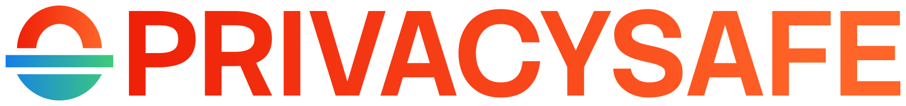

<p align="center">
  <a href="https://privacysafe.app"></a>
</p>

# PrivacySafe Community Payments

**Pay the identity. Unlock the community.**

PrivacySafe helps people monetize their communities without handing their relationships over to a social media platform or payment intermediary. Creators and groups can charge directly for private conversations, exclusive content, and access to their communities.

A podcaster can share an early episode with paying listeners. A musician can offer a private fan club. A consultant can charge for a meeting. The payment goes directly to the recipient, and access follows once it's verified.

**[Try the web demo](https://payments.privacysafe.app/app/) · [Visit the project site](https://payments.privacysafe.app/) · [Download the demo APK](https://psafe.ly/payapk) · [View the deck](https://psafe.ly/deck27)**

## John Kiriakou's Secret Agent Club

This demo shows how a listener can pay to access exclusive content from John Kiriakou. The listener chooses USDC or AUDD, pays with a Solana wallet, and gets access to a members-only episode after the payment is verified.

The demo uses a viewing pass to show the experience. The broader PrivacySafe Chat plan is to apply the same payment model to membership in private groups and secure conversations.

The demo price is **1.00 USDC or 1.40 AUDD**; it is not the proposed membership price shown in the deck.

## Direct payments, without custody

PrivacySafe Community Payments builds on PrivacySafe's existing private communications and user-controlled identities. Rather than buying an NFT or joining a Discord server to prove membership, a person pays the creator or group directly.

The demo supports two ways to pay on Solana:

- **Solana Pay:** scan a QR code or open a payment link with a compatible wallet.
- **x402:** pay from a supported wallet in the browser, or use the same payment flow from an AI agent over HTTP when x402 is enabled.

Payments use **USDC or AUDD** and go to the recipient's wallet. PrivacySafe does not hold the funds. Once the transaction is verified, the demo unlocks the content. This is the same approach we are developing for paid groups, private requests, and other forms of community access.

## Why PrivacySafe?

PrivacySafe already provides encrypted messaging, private groups, contacts, secure storage, video calls, and user-controlled identities. Community Payments adds a way for the people using those tools to get paid directly.

The goal is straightforward: creators should be able to support their work through their communities, and members should be able to pay for access without making a social media platform the middleman.

PrivacySafe is free/libre and open-source software, commercialized by [Ivy Cyber](https://ivycyber.com). The independent nonprofit [PrivacySafe Foundation](https://privacysafe.foundation) supports shared code, education, and public-interest work.

## Try it

- **[Live demo](https://payments.privacysafe.app/app/)** — try the Secret Agent Club payment experience.
- **[Project site](https://payments.privacysafe.app/)** — watch the walkthroughs and learn more.
- **[Android demo APK](https://psafe.ly/payapk)** — try the mobile demonstration.
- **[Pitch deck](https://psafe.ly/deck27)** — see the larger Community Payments plan.
- **[Colosseum Hackathon](https://psafe.ly/superteam)** — see the project submission.

**This is a proof of concept, not a production membership service.** It runs on Solana mainnet, so real payments use real funds. The web demo unlocks an episode; automatic membership in PrivacySafe Chat is not implemented here. Real-wallet and mainnet payment flows still need end-to-end testing.

## Run locally

Requires Node.js 20 or later.

```sh
npm ci
npm run build
cp .env.example .env
# Set PAY_TO to a receiving Solana wallet address.
# Set SESSION_SECRET to a strong random secret (e.g. openssl rand -hex 32).
npm start
```

The receiving wallet needs token accounts for the supported assets. Only use a **public wallet address** for `PAY_TO`; never put a private key or recovery phrase in this project. For a public deployment, use HTTPS and configure `TRUST_PROXY=1` behind a reverse proxy.

## Contributing and license

Contributions are welcome. See [CONTRIBUTING.md](CONTRIBUTING.md), [CODE_OF_CONDUCT.md](CODE_OF_CONDUCT.md), and [SECURITY.md](SECURITY.md). Report sensitive security issues using the instructions in `SECURITY.md` rather than a public issue.

Copyright © 2026 [Ivy Cyber LLC](https://ivycyber.com). Original software is licensed under the [GNU Affero General Public License v3 or later](LICENSE) (`AGPL-3.0-or-later`), unless otherwise noted. Third-party content retains its own licenses; see [NOTICE](NOTICE) and [REUSE.toml](REUSE.toml).

PrivacySafe® and 3NWeb® are registered trademarks. Free software licenses do not grant trademark rights.

[PrivacySafe](https://privacysafe.app) · [GitHub](https://github.com/PrivacySafe) · [Contact](mailto:hello@privacysafe.net)
